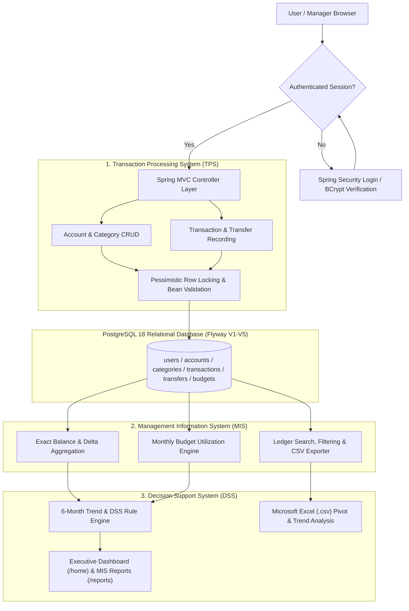
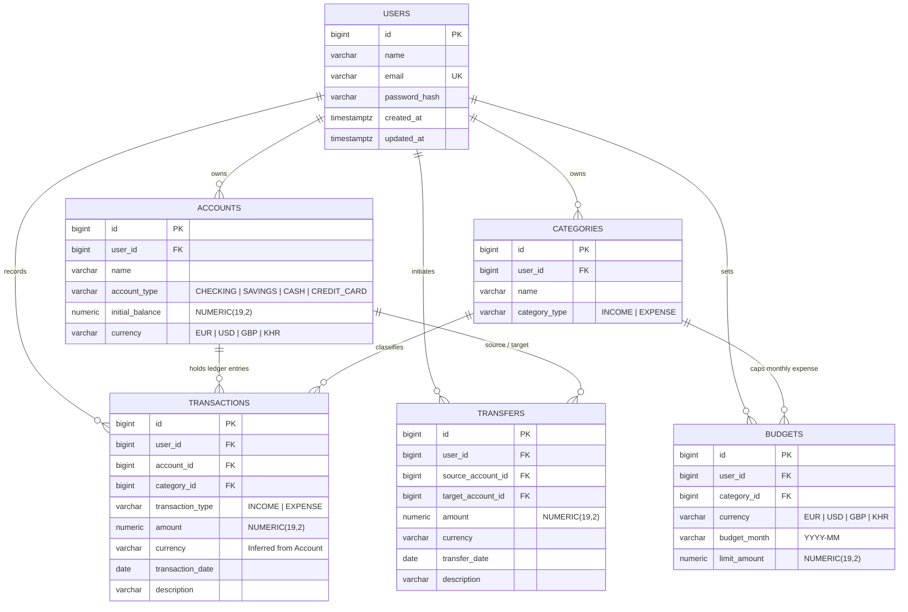
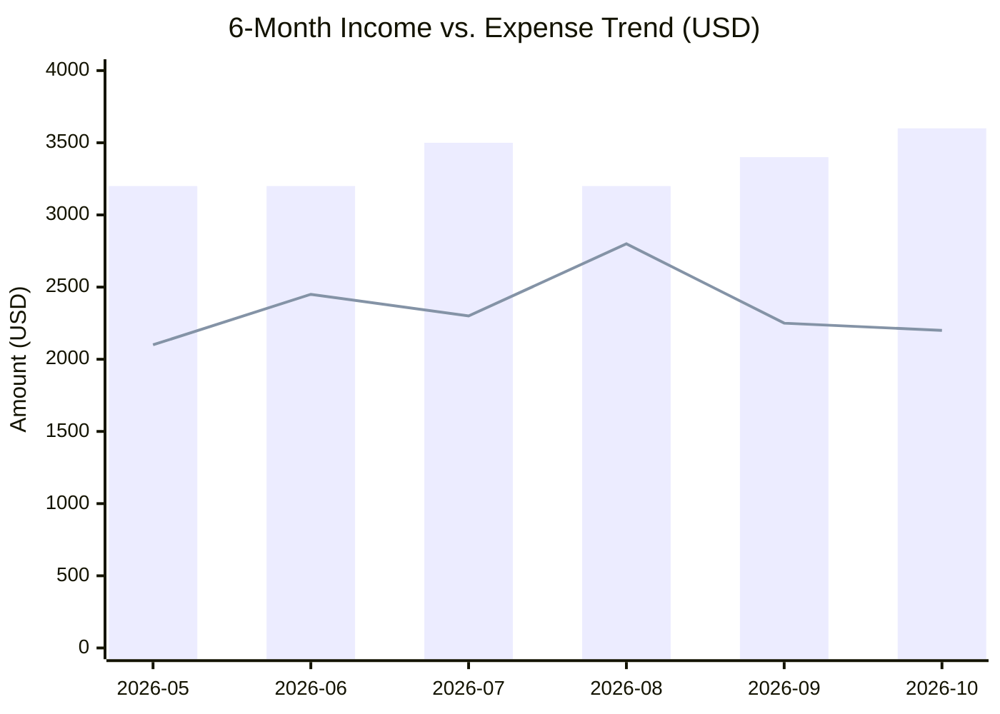
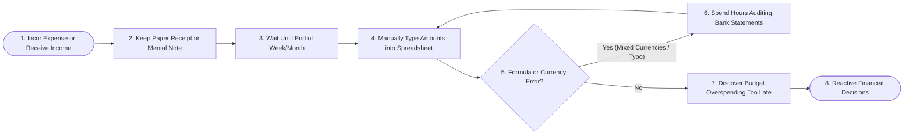
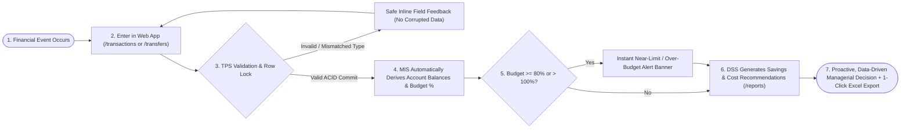

# Management Information Systems (MIS) — Complete Assignment Report

**Course**: Management Information Systems  
**Lecturer**: Pay Laten  
**System Project**: Personal Finance Tracker & Decision Support System (Spring Boot 4.1.1 + PostgreSQL 18)

---

## 1. Business Case Study Analysis

### 1.1 Simulated Organization & Context
**SME / Personal Financial Management Case ("Mekong FinTrack Advisory")**:  
Individuals and small micro-enterprises in Cambodia and internationally manage multi-currency cash flows (`USD`, `KHR`, `EUR`, `GBP`) across checking accounts, savings accounts, physical cash, and credit cards. Historically, financial tracking was performed using paper receipts, disconnected mobile notes, and ad-hoc spreadsheets.

### 1.2 Classification of Information Systems (TPS, MIS, DSS)

| System Tier | Role in Personal Finance Tracker | Implementation in Project |
| :--- | :--- | :--- |
| **TPS (Transaction Processing System)** | Captures, validates, locks, and persists daily atomic financial events (income, expenses, and same-currency account transfers) without rounding errors or race conditions. | `TransactionService`, `TransferService`, and composite foreign-key constraints in PostgreSQL. |
| **MIS (Management Information System)** | Aggregates TPS records into structured monthly summaries, multi-currency account balances, category spending shares, and budget utilization reports. | `DashboardService`, `BudgetService`, and `ReportService`. |
| **DSS (Decision Support System)** | Evaluates cash-flow velocity, savings rate benchmarks, cost concentration, and 3-month liquidity reserves to recommend concrete managerial actions. | `ReportService` (`buildDssSummary`) and interactive `/reports` dashboard (`templates/reports/index.html`). |

### 1.3 Problem Analysis (Legacy Manual / Spreadsheet Approach)
1. **Slow & Error-Prone Processes**: Manual balance recalculation across multiple currencies (`USD`, `KHR`, `EUR`) leads to formula errors and stale balances.
2. **Poor Data Flow & Fragmented History**: Deleting or renaming a category or account in a manual spreadsheet corrupts historical ledger rows.
3. **Lack of Real-Time Budget Controls**: Over-spending is only discovered at the end of the month when spreadsheets are manually reconciled.
4. **Weak Security & Multi-User Isolation**: Shared spreadsheets lack BCrypt authentication, CSRF protection, and row-level ownership isolation.

### 1.4 Recommended MIS Improvements
- **Centralized Relational TPS**: Enforce ACID transactions and composite foreign keys so historical currency and category types can never be silently corrupted.
- **Derived Real-Time Balances**: Compute current account balances dynamically from opening balances plus net ledger deltas and transfers (`NUMERIC(19,2)` exact arithmetic).
- **Automated MIS & DSS Layer**: Provide instant 6-month trend charts, automated over-budget alerts (>= 80% near-limit and > 100% over-budget), and one-click CSV exports for Excel analysis.

---

## 2. System Design Project

### 2.1 System Architecture & Data Flowchart

### 2.2 Database Design (Entity-Relationship Diagram)

---

## 3. Decision Support Scenario

### 3.1 Scenario Context
A financial manager reviews a 6-month dataset (`2026-05` to `2026-10`) in `USD` generated by the system's `/reports` module to answer three strategic questions:
1. *How much capital can be safely allocated to long-term investments each month?*
2. *Which expense category is the primary cost driver requiring budget intervention?*
3. *Does current liquidity meet the 3-month emergency operating reserve benchmark?*

### 3.2 Sample 6-Month MIS Dataset (`USD`)

| Month | Monthly Income (`USD`) | Monthly Expense (`USD`) | Net Cash Flow (`USD`) | Savings Rate (`%`) |
| :--- | :---: | :---: | :---: | :---: |
| `2026-05` | `3,200.00` | `2,100.00` | `+1,100.00` | `34%` |
| `2026-06` | `3,200.00` | `2,450.00` | `+750.00` | `23%` |
| `2026-07` | `3,500.00` | `2,300.00` | `+1,200.00` | `34%` |
| `2026-08` | `3,200.00` | `2,800.00` | `+400.00` | `13%` |
| `2026-09` | `3,400.00` | `2,250.00` | `+1,150.00` | `34%` |
| `2026-10` | `3,600.00` | `2,200.00` | `+1,400.00` | `39%` |
| **6-Month Total / Avg** | **`20,100.00`** | **`14,100.00` (`2,350.00`/mo)** | **`+6,000.00`** | **`30%`** |

### 3.3 Category Cost Breakdown (`USD`)

| Expense Category | Transactions | Total Spent (`USD`) | Average / Entry (`USD`) | Share of Total Expenses | Monthly Budget Status |
| :--- | :---: | :---: | :---: | :---: | :--- |
| **Housing & Utilities** | 6 | `6,600.00` | `1,100.00` | `47%` | On Track (`1,100 / 1,100`) |
| **Food & Dining** | 48 | `4,230.00` | `88.13` | `30%` | **Over Budget** (`780 / 600` in Oct) |
| **Transport & Fuel** | 24 | `1,880.00` | `78.33` | `13%` | Near Limit (`88%`) |
| **Software & Subscriptions** | 12 | `1,390.00` | `115.83` | `10%` | On Track |

### 3.4 Data-Driven Managerial Decisions (DSS Output)
1. **Capital Allocation Decision**: Because the 6-month savings rate is **30%** (`+6,000.00 USD` net surplus, exceeding the 20% target), the manager can safely allocate **50% of the net surplus (`3,000.00 USD`, or `500.00 USD/month`)** into a high-yield term deposit or investment portfolio.
2. **Cost Control Decision**: **Food & Dining** represents **30%** of total expenses (`4,230.00 USD`) and exceeded its October monthly budget by `180.00 USD` (`130%` utilization). Enforcing a 15% reduction in dining out saves **`634.50 USD`** per 6-month cycle.
3. **Liquidity Reserve Decision**: Average monthly operating expense is `2,350.00 USD`, requiring a 3-month emergency reserve of **`7,050.00 USD`**. Any checking balance above `7,050.00 USD` should be swept into the Savings account via the `/transfers` module.

---

## 4. Excel / Data Analysis & Visualization Task

### 4.1 6-Month Cash Flow Trend Visualization

### 4.2 Exporting Data to Microsoft Excel
The application provides two dedicated CSV export endpoints designed for direct import into **Microsoft Excel**:
1. **Executive MIS Summary Export (`GET /reports/export-monthly.csv`)**: Exports both the 6-month time-series cash-flow table and the aggregated category performance breakdown.
2. **Filtered TPS Ledger Export (`GET /transactions/export.csv`)**: Exports individual transaction rows (`Date, Type, Category, Account, Amount, Currency, Description`) with formula-injection protection.

---

### 4.3 In-App Executive Dashboard Analytics (`/home`)

The application computes the same Part 4 analysis live from the ledger:

| Dashboard Component | Statistical Method | Example Output (USD, Oct 2026) |
| :--- | :--- | :--- |
| 6-Month Savings Efficiency | (Σ Income − Σ Expense) ÷ Σ Income vs. 20% benchmark | 42% saved (+$4,672.00 net) |
| Emergency Liquidity Runway | Current Balance ÷ AVERAGE(monthly expense) | ≈ 9.0 months vs. 3-month benchmark ($3,239.01) |
| Primary Cost Driver | MAX(SUM by category) with COUNT and AVERAGE | Housing & Rent — 42%, 6 entries, $450.00 avg |
| Budget Variance Signal | COUNT(budgets where spent > limit) | 1 over limit (Food & Dining 111.8%) |
| 6-Month Trend Chart | Monthly SUM income vs. expense | Side-by-side bars May–Oct with net & savings % |
| Expense Composition Chart | Category share % stacked bar + COUNT/AVERAGE/SUM table | Housing 42% · Food 33% · Transport 10% · Utilities 9% · Education 6% |
| Account Liquidity Split | Account balance ÷ total positive balance | Checking vs. Emergency Reserve |

> Screenshot placeholder: insert a capture of `http://localhost:8080/home` (demo@mis.edu.kh), USD and KHR tabs.

## 5. Business Process Mapping ("As-Is" vs. "To-Be")

### 5.1 "As-Is" Process (Legacy Manual / Disconnected Spreadsheet Process)

### 5.2 "To-Be" Process (Automated Personal Finance MIS & DSS Workflow)

