# Management Information Systems (MIS) — Complete Assignment Report

**Course**: Management Information Systems  
**Lecturer**: Pay Laten  
**System Project**: Personal Finance Tracker & Decision Support System (Spring Boot 4.1.1 + PostgreSQL 18)

---

## 1. Business Case Study Analysis

### 1.1 Simulated Organization & Context
**SME / Personal Financial Management Case ("Mekong FinTrack Advisory")**:  
Individuals and small micro-enterprises in Cambodia and internationally manage multi-currency cash flows (`USD`, `KHR`, `EUR`, `GBP`) across checking accounts, savings accounts, physical cash, and credit cards. Historically, financial tracking was performed using paper receipts, disconnected mobile notes, and ad-hoc spreadsheets.

### 1.2 Classification of Information Systems (TPS, MIS, DSS)

| System Tier | Role in Personal Finance Tracker | Implementation in Project |
| :--- | :--- | :--- |
| **TPS (Transaction Processing System)** | Captures, validates, locks, and persists daily atomic financial events (income, expenses, and same-currency account transfers) without rounding errors or race conditions. | `TransactionService`, `TransferService`, and composite foreign-key constraints in PostgreSQL. |
| **MIS (Management Information System)** | Aggregates TPS records into structured monthly summaries, multi-currency account balances, category spending shares, and budget utilization reports. | `DashboardService`, `BudgetService`, and `ReportService`. |
| **DSS (Decision Support System)** | Evaluates cash-flow velocity, savings rate benchmarks, cost concentration, and 3-month liquidity reserves to recommend concrete managerial actions. | `ReportService` (`buildDssSummary`) and interactive `/reports` dashboard (`templates/reports/index.html`). |

### 1.3 Problem Analysis (Legacy Manual / Spreadsheet Approach)
1. **Slow & Error-Prone Processes**: Manual balance recalculation across multiple currencies (`USD`, `KHR`, `EUR`) leads to formula errors and stale balances.
2. **Poor Data Flow & Fragmented History**: Deleting or renaming a category or account in a manual spreadsheet corrupts historical ledger rows.
3. **Lack of Real-Time Budget Controls**: Over-spending is only discovered at the end of the month when spreadsheets are manually reconciled.
4. **Weak Security & Multi-User Isolation**: Shared spreadsheets lack BCrypt authentication, CSRF protection, and row-level ownership isolation.

### 1.4 Recommended MIS Improvements
- **Centralized Relational TPS**: Enforce ACID transactions and composite foreign keys so historical currency and category types can never be silently corrupted.
- **Derived Real-Time Balances**: Compute current account balances dynamically from opening balances plus net ledger deltas and transfers (`NUMERIC(19,2)` exact arithmetic).
- **Automated MIS & DSS Layer**: Provide instant 6-month trend charts, automated over-budget alerts (>= 80% near-limit and > 100% over-budget), and one-click CSV exports for Excel analysis.

---

## 2. System Design Project

### 2.1 System Architecture & Data Flowchart

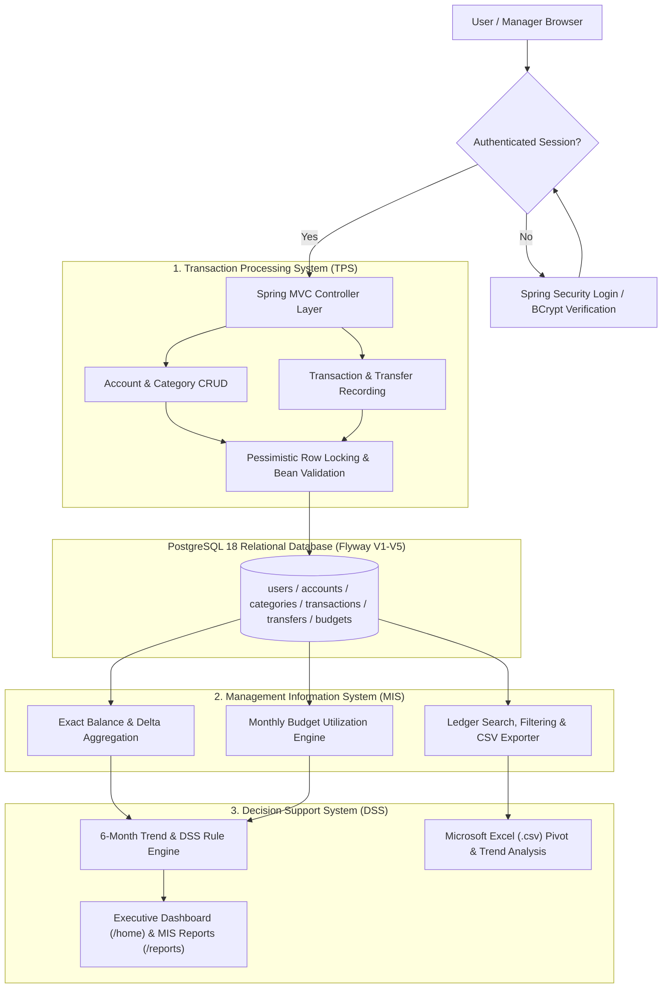

### 2.2 Database Design (Entity-Relationship Diagram)

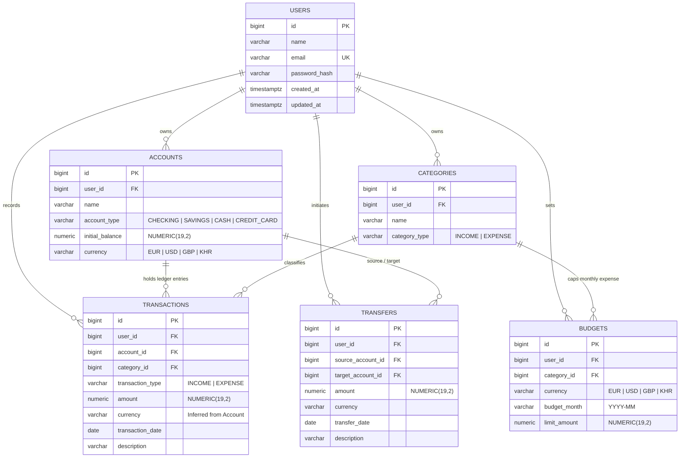

---

## 3. Decision Support Scenario

### 3.1 Scenario Context
A financial manager reviews the fixed synthetic classroom dataset (`2026-05` to `2026-10`) in `mis_transactions_6months.csv` to answer three strategic questions. This 66-entry source is shared by the workbook and presentation; it is not private customer data. The live application uses a rolling six-month window, so its date range advances with the server date.
1. *How much capital can be safely allocated to long-term investments each month?*
2. *Which expense category is the primary cost driver requiring budget intervention?*
3. *Does current liquidity meet the 3-month emergency operating reserve benchmark?*

### 3.2 Sample 6-Month MIS Dataset (`USD`)

| Month | Monthly Income (`USD`) | Monthly Expense (`USD`) | Net Cash Flow (`USD`) | Savings Rate (`%`) |
| :--- | :---: | :---: | :---: | :---: |
| `2026-05` | `1,750.00` | `1,005.00` | `+745.00` | `43%` |
| `2026-06` | `1,900.00` | `1,062.00` | `+838.00` | `44%` |
| `2026-07` | `1,680.00` | `1,128.00` | `+552.00` | `33%` |
| `2026-08` | `2,020.00` | `1,038.00` | `+982.00` | `49%` |
| `2026-09` | `1,850.00` | `1,089.00` | `+761.00` | `41%` |
| `2026-10` | `1,950.00` | `1,156.00` | `+794.00` | `41%` |
| **6-Month Total / Avg** | **`11,150.00`** | **`6,478.00` (`1,079.67`/mo)** | **`+4,672.00`** | **`42%`** |

### 3.3 Category Cost Breakdown (`USD`)

| Expense Category | Transactions | Total Spent (`USD`) | Average / Entry (`USD`) | Share of Total Expenses | Monthly Budget Status |
| :--- | :---: | :---: | :---: | :---: | :--- |
| **Housing & Rent** | 6 | `2,700.00` | `450.00` | `42%` | No assumed budget |
| **Food & Dining** | 6 | `2,165.00` | `360.83` | `33%` | **Over Budget** (`425 / 380` in Oct; limit is a scenario assumption) |
| **Transport & Fuel** | 6 | `670.00` | `111.67` | `10%` | No assumed budget |
| **Utilities & Internet** | 6 | `553.00` | `92.17` | `9%` | No assumed budget |
| **Education & Books** | 6 | `390.00` | `65.00` | `6%` | No assumed budget |

### 3.4 Data-Driven Managerial Decisions (DSS Output)
1. **Capital Allocation Decision**: The savings rate is **42%** (`+4,672.00 USD` net surplus). An illustrative 50% allocation is **`2,336.00 USD`**, subject to maintaining reserves and assessing risk. A **5.5% APY** term deposit is a classroom assumption, not an available product or guaranteed return; its illustrative one-year yield would be `128.48 USD`.
2. **Cost Control Decision**: Housing is the largest cost (`2,700.00 USD`, 42%), but Food & Dining is a controllable expense (`2,165.00 USD`, 33%). October food spending exceeds the assumed `380.00 USD` limit by **`45.00 USD`** (111.8% utilization). A 15% six-month food reduction saves **`324.75 USD`**; October spending would fall from `425.00` to `361.25`, below the limit.
3. **Liquidity Reserve Decision**: Round the monthly expense average to `1,079.67 USD` before multiplying by three, matching the application's reporting convention: reserve target **`3,239.01 USD`**. Assumed opening USD funds total `5,050.00`, so closing USD funds are **`9,722.00`** (`5,050.00 + 4,672.00`). After the illustrative `2,336.00` allocation, `7,386.00` remains, above the target. These are educational decision rules, not financial advice.

**KHR stays separate:** income `9,600,000`, expense `6,600,000`, net `3,000,000`, and rounded savings rate `31%`. No exchange-rate assumption or USD/KHR combined total is used.

---

## 4. Excel / Data Analysis & Visualization Task

### 4.1 6-Month Cash Flow Trend Visualization
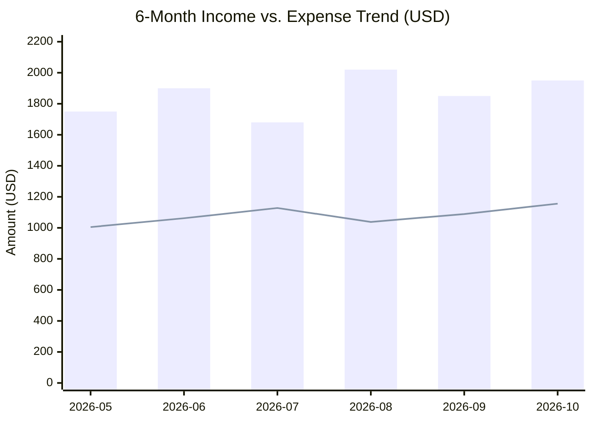

### 4.2 Exporting Data to Microsoft Excel
The application provides two dedicated CSV export endpoints designed for direct import into **Microsoft Excel**:
1. **Executive MIS Summary Export (`GET /reports/export-monthly.csv`)**: Exports both the 6-month time-series cash-flow table and the aggregated category performance breakdown.
2. **Filtered TPS Ledger Export (`GET /transactions/export.csv`)**: Exports individual transaction rows (`Date, Type, Category, Account, Amount, Currency, Description`) with formula-injection protection.

---

### 4.3 In-App Executive Dashboard Analytics (`/home`)

The application computes the same Part 4 analysis live from the ledger:

| Dashboard Component | Statistical Method | Example Output (USD, Oct 2026) |
| :--- | :--- | :--- |
| 6-Month Savings Efficiency | (Σ Income − Σ Expense) ÷ Σ Income vs. 20% benchmark | Fixed case: 42% saved (+$4,672.00 net) |
| Emergency Liquidity Runway | Current Balance ÷ AVERAGE(monthly expense) | ≈ 9.0 months vs. 3-month benchmark ($3,239.01) |
| Primary Cost Driver | MAX(SUM by category) with COUNT and AVERAGE | Housing & Rent — 42%, 6 entries, $450.00 avg |
| Budget Variance Signal | COUNT(budgets where spent > limit) | 1 over limit (Food & Dining 111.8%) |
| 6-Month Trend Chart | Monthly SUM income vs. expense | Side-by-side bars May–Oct with net & savings % |
| Expense Composition Chart | Category share % stacked bar + COUNT/AVERAGE/SUM table | Housing 42% · Food 33% · Transport 10% · Utilities 9% · Education 6% |
| Account Liquidity Split | Account balance ÷ total positive balance | Checking vs. Emergency Reserve |

### 4.4 Native Excel dashboard and charts

Open `MIS_Financial_Analysis.xlsx` on **`0_Executive_Dashboard`**. Six native,
editable Excel charts show USD income/expenses, USD net cash flow, USD expense
composition, USD savings-rate trend, KHR income/expenses, and USD category spending.
The original three worksheets and 66 ledger entries are preserved. `SUMIFS` and
`COUNTIFS` connect monthly/category summaries to the ledger; `SUM`, `AVERAGE`,
`COUNT`, and rounded decision formulas remain visible. Cached formula/chart values
are included, and Excel recalculates formulas on opening.

### 4.5 Real application evidence

The following captures use the same synthetic CSV in an isolated database, not
private user data. The accounts view reconciles to `9,722.00 USD`; the ledger is
filtered to the fixed May–October 2026 study period. The dashboard is a real current-date
view: its rolling window and current-month figures can differ from the fixed-period
Excel study. This difference is intentional and must not be presented as a dataset mismatch.

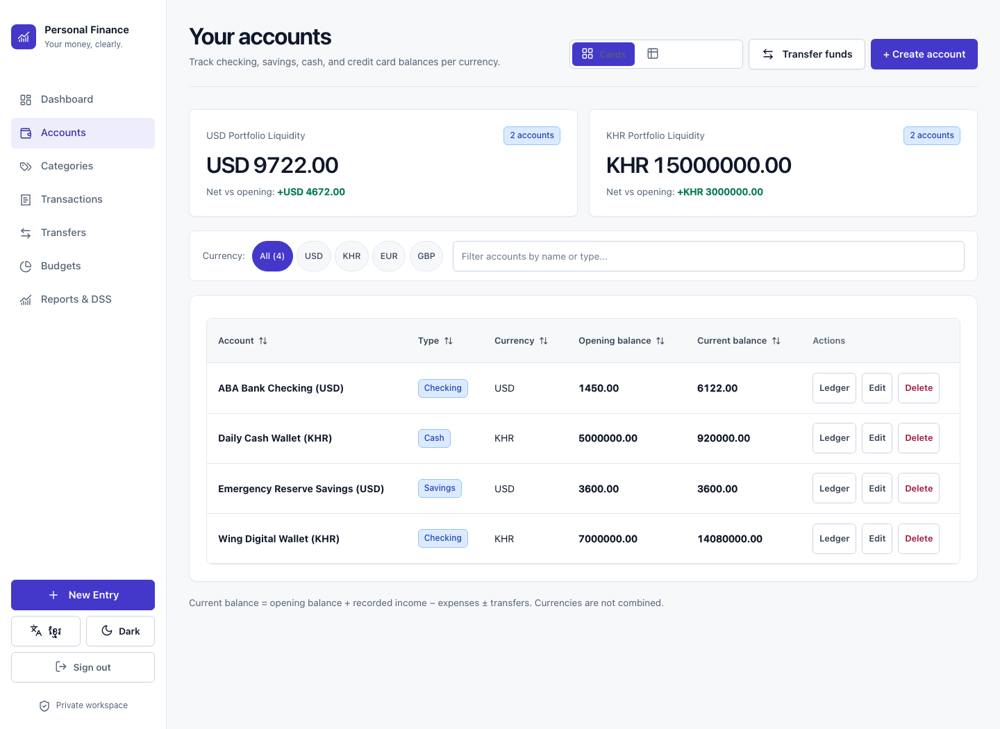
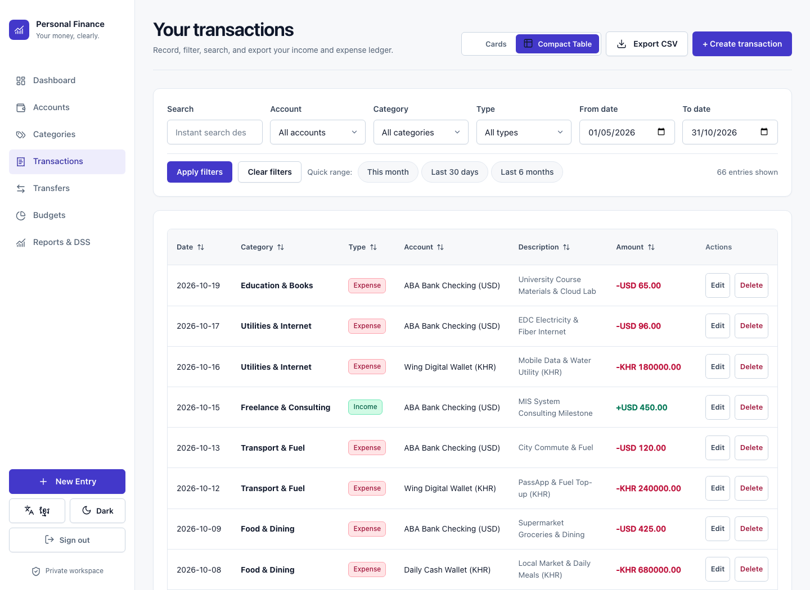
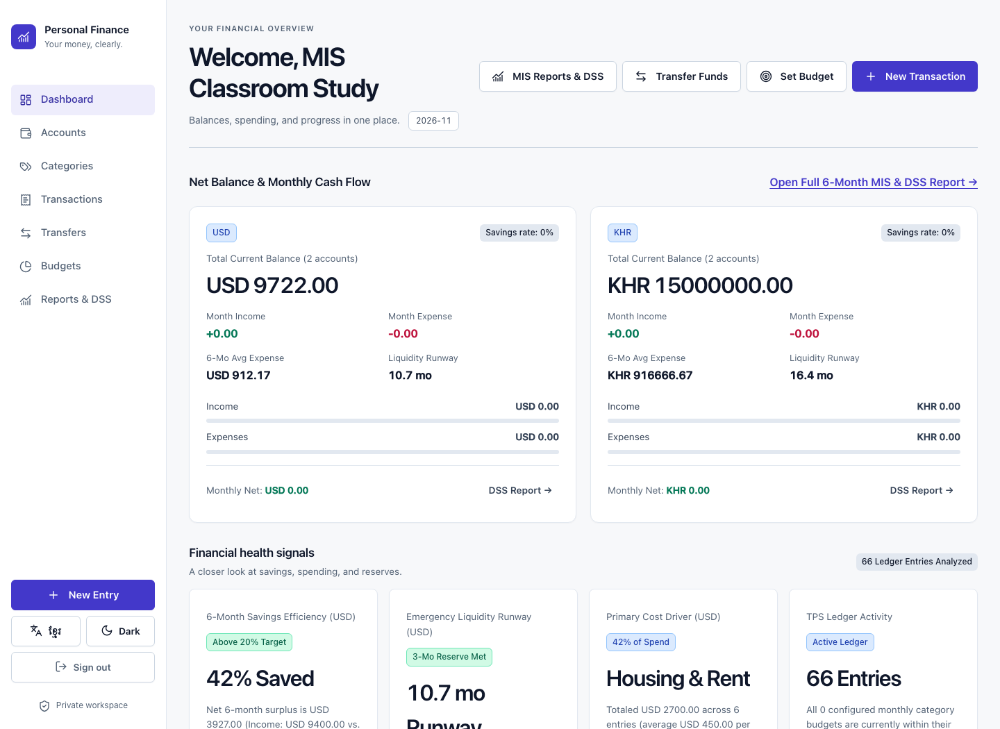

### 4.6 Rendered submission diagrams

These locally stored SVGs are generated from the Mermaid source in this report and
are embedded in the print-ready HTML/PDF, with no live Mermaid/CDN requirement:

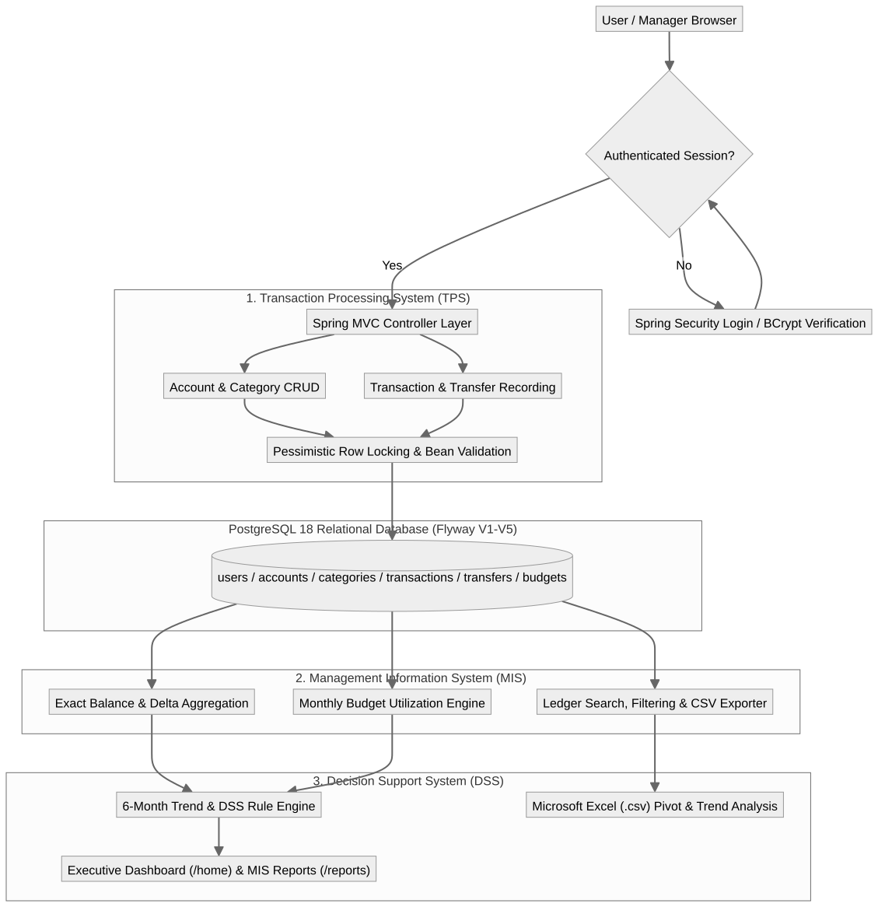
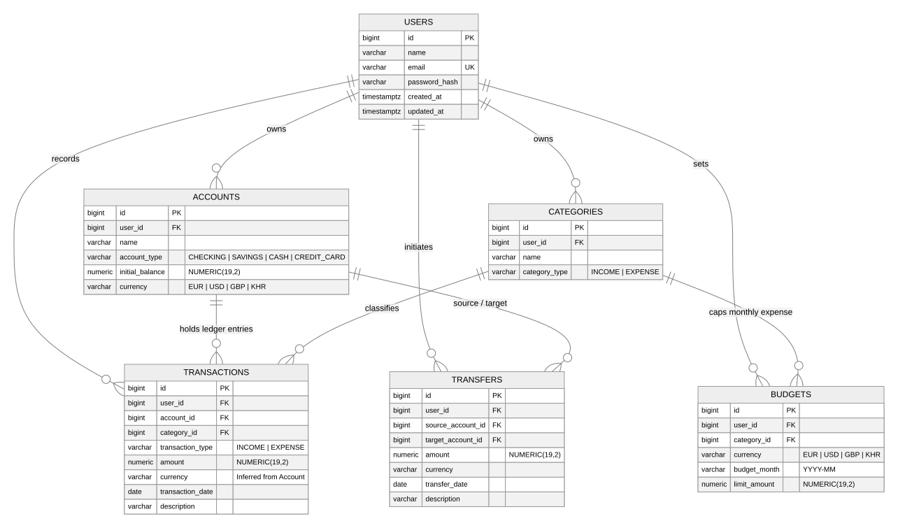
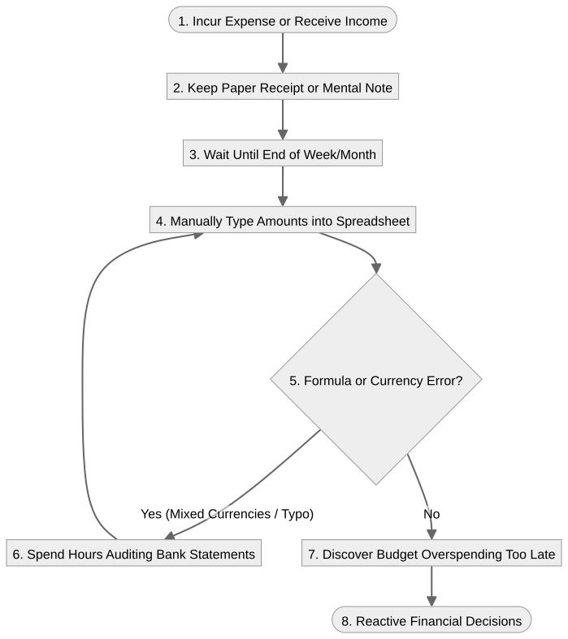
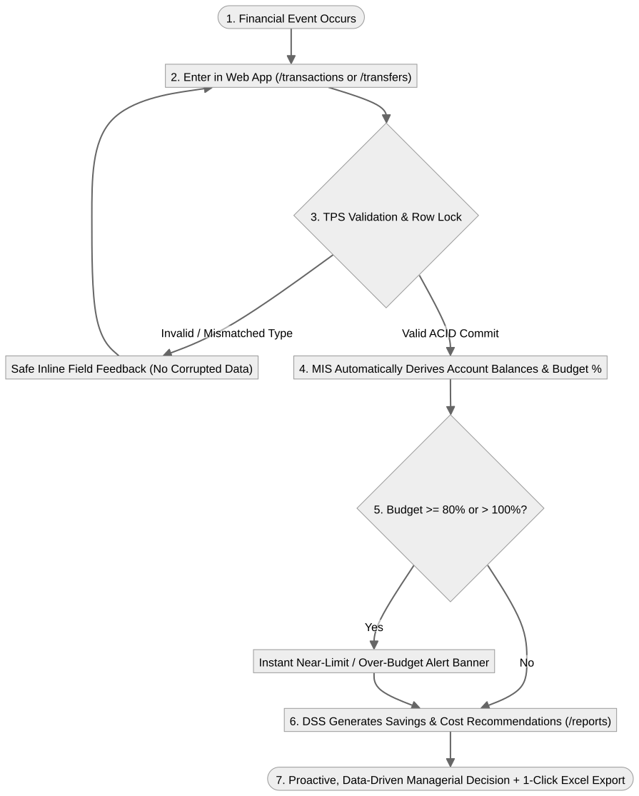

## 5. Business Process Mapping ("As-Is" vs. "To-Be")

### 5.1 "As-Is" Process (Legacy Manual / Disconnected Spreadsheet Process)

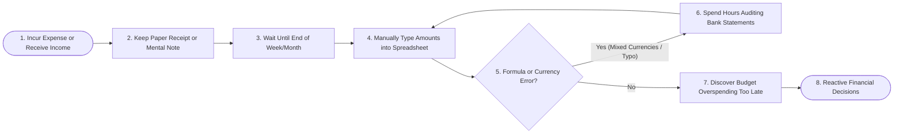

### 5.2 "To-Be" Process (Automated Personal Finance MIS & DSS Workflow)

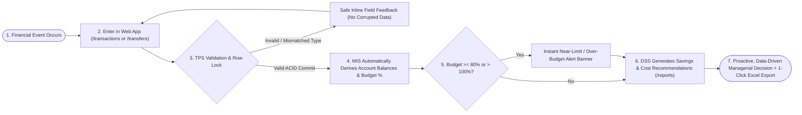
